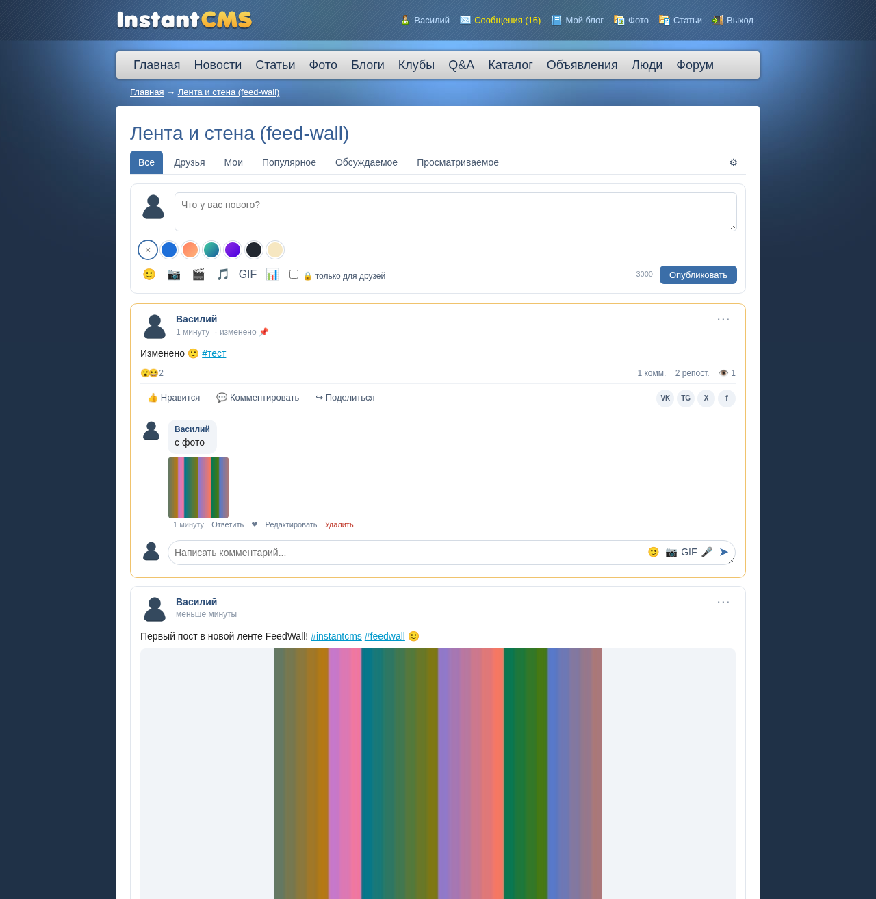
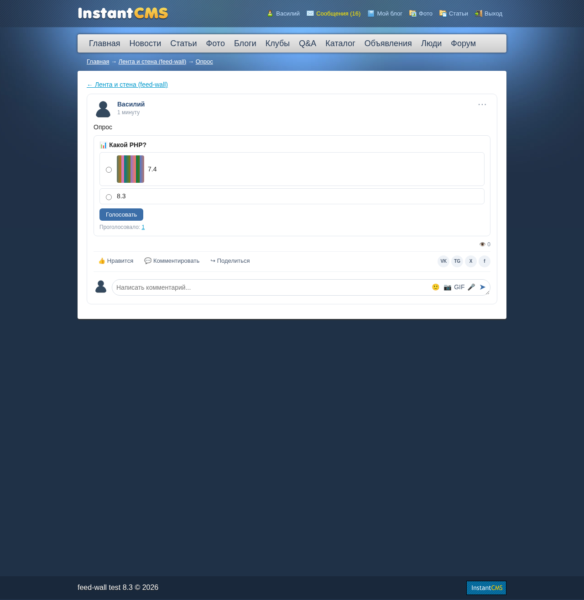
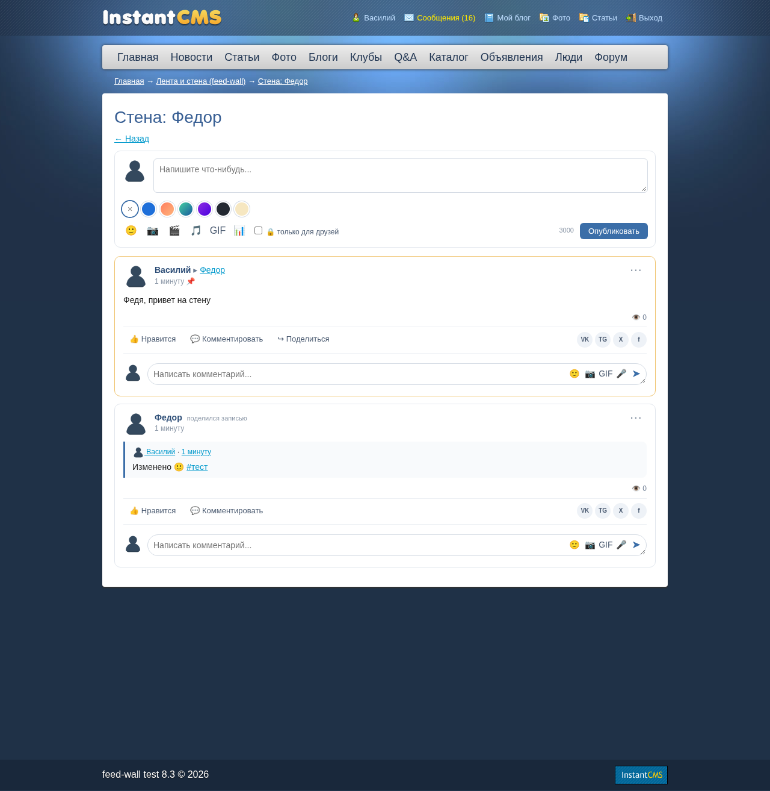
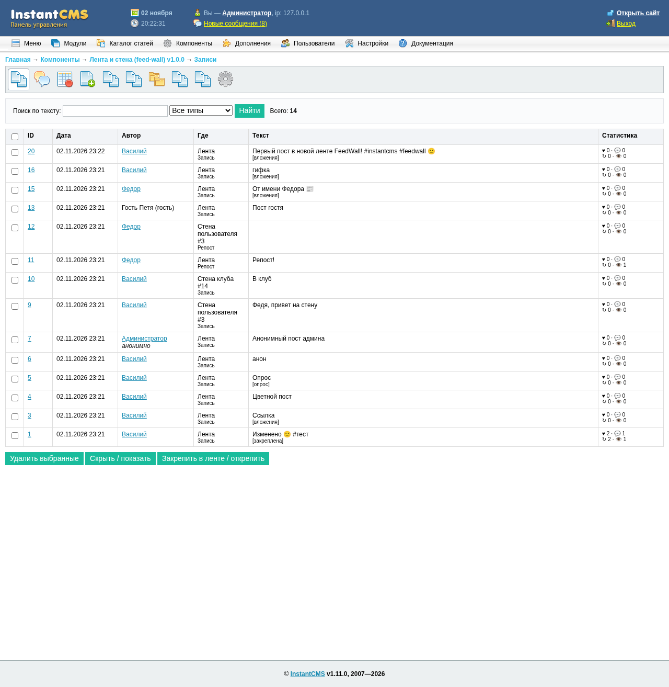

# FeedWall (feed-wall) — лента и стена для InstantCMS 1.x

**FeedWall** — компонент новостной ленты и «умной стены» для **InstantCMS 1.11.0**: возможности двух дополнений («Лента» и «Стена») для InstantCMS 2.x собраны в одном компоненте, при этом код FeedWall написан для ветки 1.x с нуля.

## Требования

- InstantCMS **1.11.0**
- PHP **7.4 – 8.3**
- MySQL **8** (strict mode, utf8mb4); MySQL 5.7 и MariaDB 10.3+ тоже должны работать, но не проверялись
- PHP-расширения: mysqli, gd, mbstring, curl (для превью ссылок и RSS)

## Установка

1. Скачайте `feedwall_v1.0.0.zip` со страницы [релизов](https://github.com/StudiaHive/FeedWall/releases/latest).
2. Распакуйте архив **в корень сайта**. Структура архива повторяет структуру сайта: `components/`, `admin/`, `modules/`, `plugins/`, `languages/`, `templates/_default_/`.
3. В админке откройте **Дополнения → Установить компоненты** и установите «Лента и стена (feed-wall)».
   Прямая ссылка: `/admin/index.php?view=install&do=component`.
4. Компонент сам создаёт таблицы, плагины `p_feedwall` и `p_feedwall_likes`, модули, задачу CRON `feedwall_cron` и права групп.
5. Модули устанавливаются **без привязки к позициям**. Включите их и назначьте позиции в разделе **Модули**.
6. Настройки компонента: **Компоненты → Лента и стена → Настройки**.

Если у вашего шаблона нет своих файлов `com_feedwall_*.tpl`, используются файлы из `templates/_default_/`.

### Обновление

Распакуйте новую версию поверх старой и выберите в **Дополнения → Установить компоненты** пункт обновления компонента. Недостающие таблицы и колонки будут добавлены, а данные сохранятся.

## Удаление

Откройте **Компоненты**, найдите «Лента и стена» и нажмите **Удалить**. Будет удалено всё, что добавил компонент:
- таблицы `cms_feedwall_*`;
- плагины и их события;
- модули и их привязки;
- задача CRON;
- записи ленты активности;
- права групп;
- папка `upload/feedwall`.

Файлы компонента удалите вручную; их список есть в архиве.

## Возможности

| Возможность | |
|---|---|
| Общая лента: вкладки «Все», «Друзья», «Мои», «Популярное», «Обсуждаемое», «Просматриваемое» | ✔ |
| Стены пользователей и клубов, режим замены системной стены | ✔ |
| Текст со смайлами, #хэштегами (страницы и облако тегов) и @упоминаниями | ✔ |
| Фото (несколько в записи), аудио, голосовые сообщения | ✔ |
| Видео YouTube, Vimeo, RuTube, VK, Facebook; превью ссылок с защитой от SSRF | ✔ |
| Цветные фоны, опросы (одиночный и множественный выбор, картинки в вариантах), GIF (свои категории или Tenor) | ✔ |
| Анонимные записи, записи «только для друзей», публикация от имени другого пользователя (админ) | ✔ |
| Закрепление на стене и в ленте, редактирование с ограничением по времени, удаление | ✔ |
| Реакции, лайки, список оценивших, вкладка «Понравилось» | ✔ |
| Комментарии с ответами, фото, GIF, голосом и лайками | ✔ |
| Репосты, кнопки «Поделиться» (VK, Telegram, X, Facebook) | ✔ |
| Жалобы с модерацией, скрытие записей, счётчик просмотров, всплывающая карточка пользователя | ✔ |
| Бесконечная прокрутка или кнопка «Показать ещё» | ✔ |
| Настройки приватности пользователя: кто может писать на стену и комментировать | ✔ |
| Гостевые записи с капчей, дневной лимит, лимиты на длину и вложения | ✔ |
| Реклама в ленте со статистикой показов и переходов | ✔ |
| Импорт RSS по CRON | ✔ |
| Рейтинг (карма) за активность, «проверенные» группы и пользователи | ✔ |
| Модули: форма публикации, список записей, облако тегов | ✔ |
| Поиск по записям, интеграция с лентой активности, вкладки в профиле | ✔ |
| Админка: записи, комментарии, жалобы, «от имени», реклама, GIF, фоны, RSS, инструменты (пересчёт, очистка, синхронизация, проверка схемы) | ✔ |
| Защита: CSRF-токены, экранирование, проверка загружаемых файлов, strict SQL, utf8mb4 (эмодзи) | ✔ |
| Языки: русский и английский | ✔ |

## Скриншоты

| | |
|---|---|
|  |  |
|  |  |

## Ограничения версии 1.0.0

- Нет интеграции с биллингом (в 1.x нет штатного биллинга).
- Голосовые сообщения записываются в браузере, на сервер загружаются файлы webm, ogg, mp3, m4a или wav.
- Анимированные GIF, загруженные как фото, сохраняются как JPEG. Для анимации используйте GIF-галерею.
- Встраивание Facebook работает по возможности. Tenor работает только с вашим API-ключом.
- Поиск (psearch) не учитывает приватность стен.

## Лицензия

GNU GPL v2. См. [LICENSE](LICENSE).
© StudiaHive / InstantCMS community revival. InstantCMS © InstantSoft.

Код FeedWall оригинальный. Дополнения «Лента» (feed 1.3.3) и «Умная стена» (smartwall 1.1.5) от My-InstantCMS.Ru для InstantCMS 2.x использовались только как образец набора функций. Их код и библиотеки в FeedWall не входят.

---

## English

**FeedWall** is a news feed and "smart wall" component for **InstantCMS 1.11.0**. It combines the features of two InstantCMS 2.x add-ons, "Feed" and "Smart Wall", in a single component. The code was written from scratch for the 1.x branch.

**Requirements:** InstantCMS 1.11.0, PHP 7.4–8.3, MySQL 8 (strict, utf8mb4).

**Install:**
1. Unzip `feedwall_v1.0.0.zip` into the site root.
2. Go to Admin → Add-ons → Install components and install "feed-wall".
3. Assign the modules to positions under Modules. They are installed unbound.

**Uninstall:** Admin → Components → feed-wall → Delete. This removes the tables, plugins, modules, the cron job, group rights and `upload/feedwall`.

**Features:**
- Global feed with tabs, user and club walls;
- photos, audio, voice, video embeds, link previews, colored posts, polls, GIFs;
- anonymous and friends-only posts, posting as another user, pinning;
- reactions, threaded comments, reposts and sharing;
- complaints, view counters, user privacy settings, guest posting with captcha;
- in-feed ads with stats, RSS import;
- 3 modules and 2 plugins, a full admin backend, RU/EN languages.

**License:** GPL v2, © StudiaHive / InstantCMS community revival.
